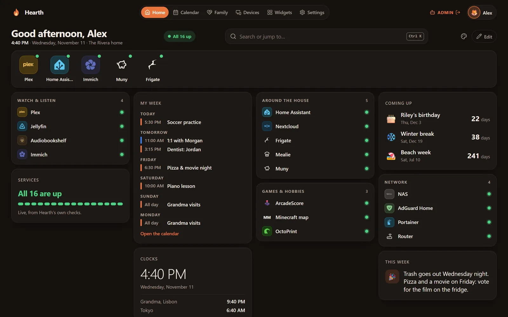
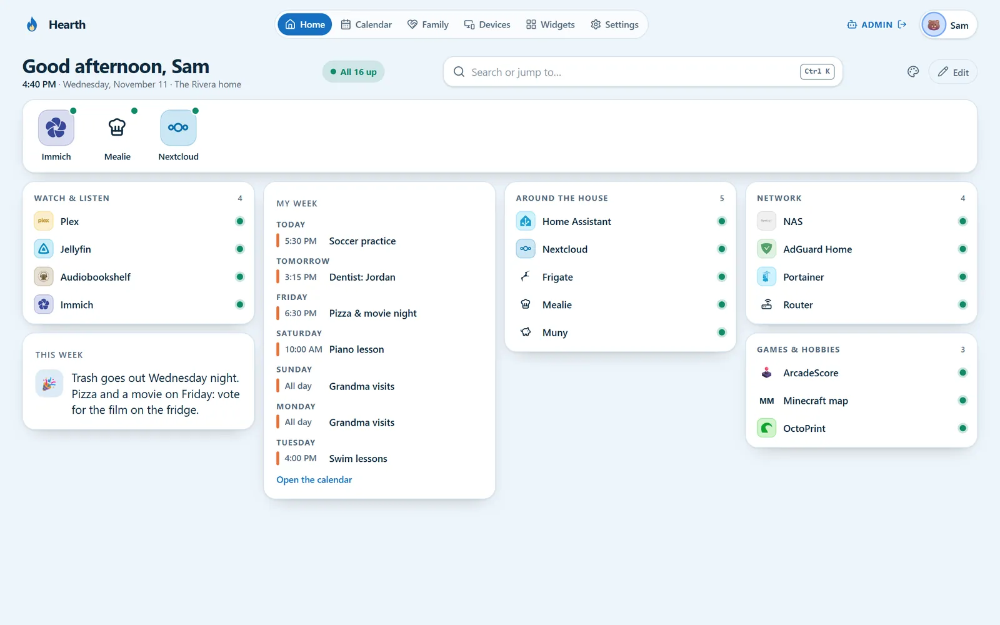
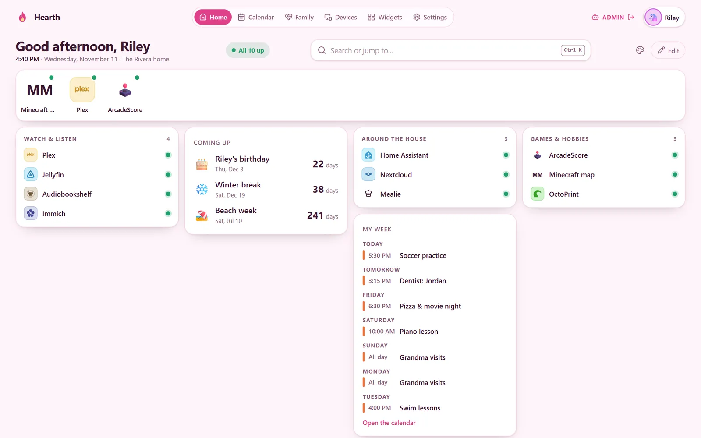
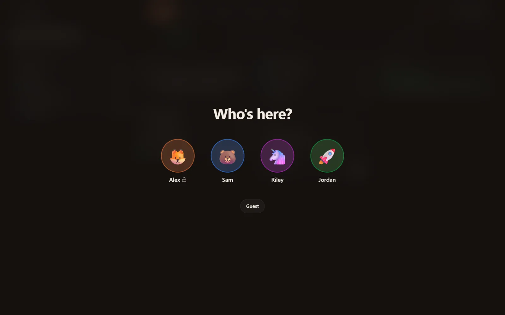
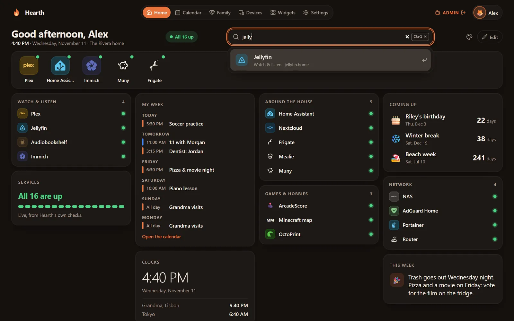
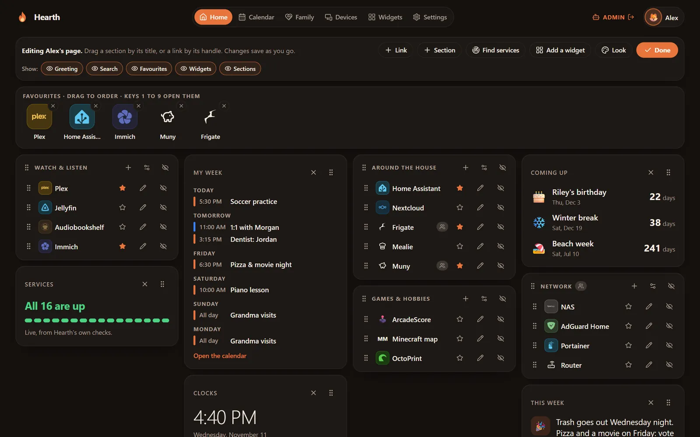
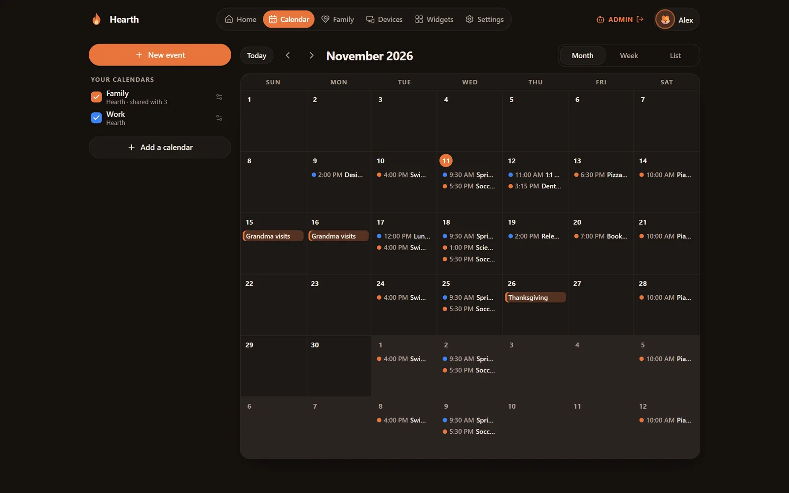
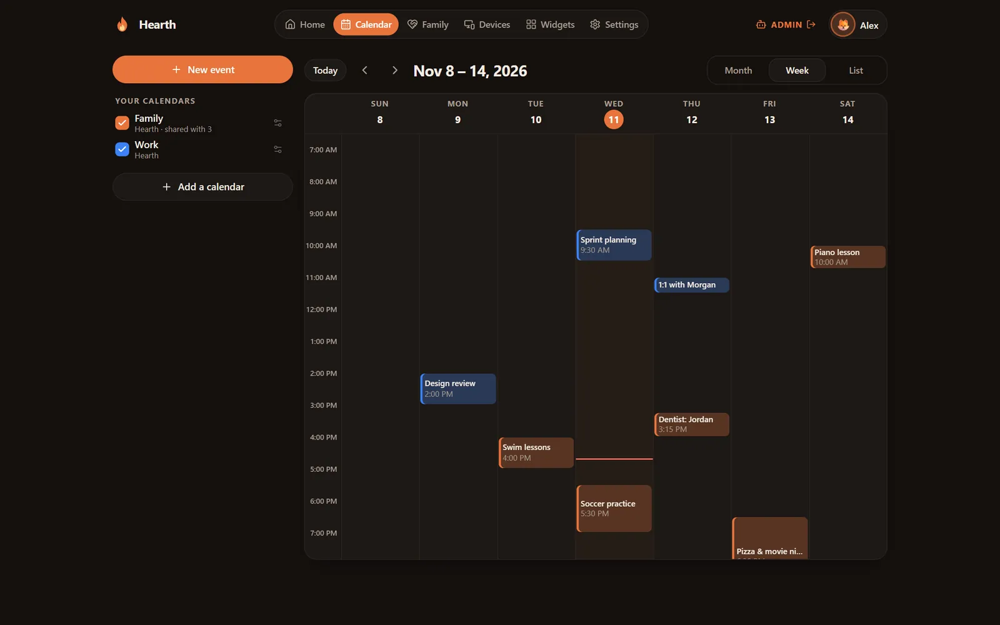
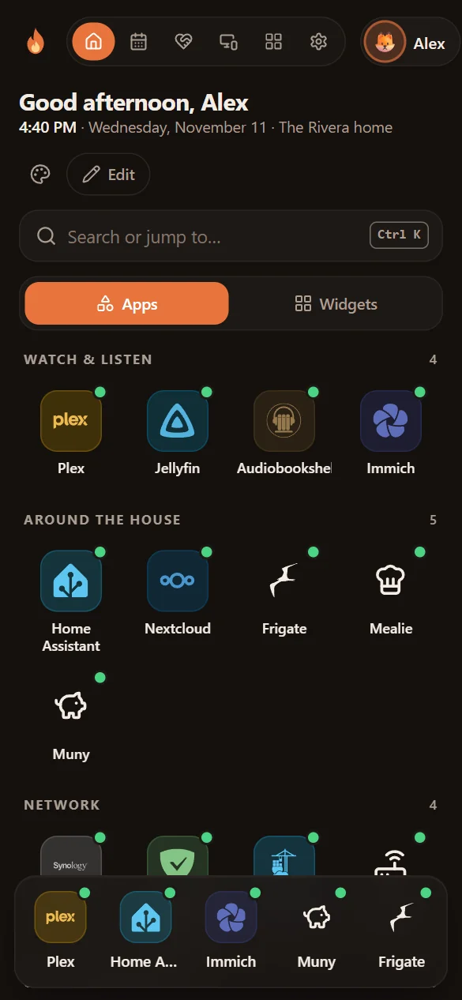
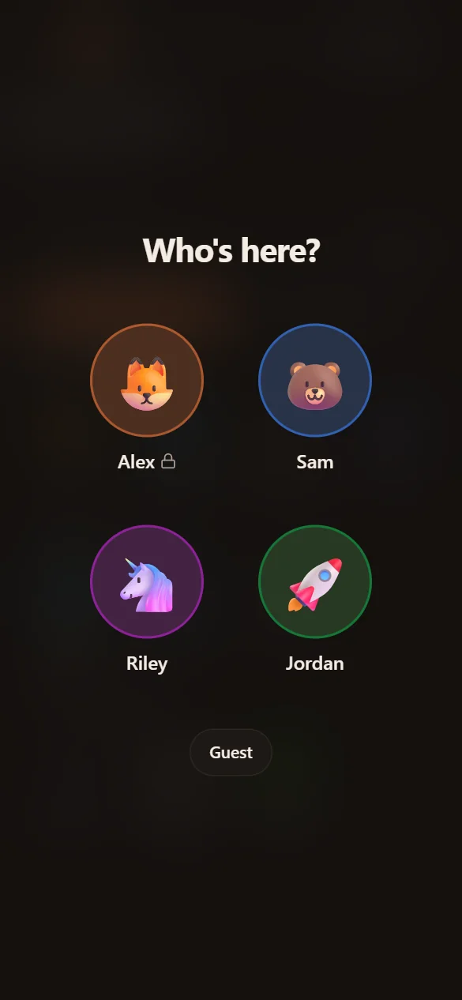

<div align="center">


# Hearth

**The front door to your home network: a start page for the whole family.**

Every service in the house one tap away with a live status dot, a page for each person, widgets for what the home runs, everyone's own calendar, and the NAS's files.
Self-hosted in one container. Nothing leaves your network unless you decide it should.

[](https://github.com/mikedmor/hearth/actions/workflows/ci.yml)
[](https://github.com/mikedmor/hearth/releases)
[](https://github.com/mikedmor/hearth/pkgs/container/hearth)
[](LICENSE)
[](https://www.paypal.com/donate/?hosted_button_id=HGMY3TA5T7NDQ)

[Quick start](#quick-start) · [Features](#features) · [Screenshots](#screenshots) · [Documentation](guides/README.md) · [Changelog](CHANGELOG.md) · [Support](#support-the-project)

</div>



## Why Hearth

A home with a NAS soon runs a dozen services, each at its own address and port, and nobody but the person who set them up remembers where they are. A list of links helps, but it's the same list for everyone, it doesn't know what's up or down, and it's awkward on a phone.

- **One address for everything.** Open `start.home` (or whatever you call it), tap your face, tap what you want. Every service on the home network gets a live dot, and the same box searches the web.
- **Everyone's own.** Each person has their own page: their links and sections, favourites, widgets, colours and theme. A child's page shows what's right for them; a parent's can hold things nobody else sees, behind a PIN.
- **Knows the house.** Widgets show what the home runs right now, the Devices page shows everything on the network, and parents get gentle internet controls for the children.
- **Yours.** It runs on your own hardware with plain JSON files. No account with anyone, no telemetry, nothing fetched from the internet unless you turn it on.

## Quick start

You need Docker on any amd64 or arm64 machine.

```sh
mkdir -p hearth/data && cd hearth
umask 077; printf "HEARTH_SECRET_KEY=%s\n" "$(openssl rand -base64 32)" > .env
docker run -d --name hearth --restart unless-stopped --user "$(id -u):$(id -g)" \
  -p 8082:8082 --env-file .env -v "$PWD/data:/data" ghcr.io/mikedmor/hearth:1
```

Open **http://localhost:8082**. The first visit asks for a setup code, which is in the container's log (`docker logs hearth`), and then for the admin password you choose.

> [!IMPORTANT]
> Keep a copy of `.env` somewhere safe, such as a password manager. `HEARTH_SECRET_KEY` encrypts widget keys, AI keys, calendar and NAS sign-ins, and without it you'd have to enter them again.

For Docker Compose, Synology, a name like `start.home` and every setting, see the **[install guide](guides/install.md)**. Then read **[getting started](guides/getting-started.md)** for a tour of your first hour.

## Features

<table>
<tr>
<td width="50%" valign="top">

### The start page

- **Sections and links** for every service, with over 7,000 bundled logos, symbols and emoji, the site's own icon, or an upload
- **Live status:** each service on the home network checked every 30 seconds
- **Search and jump** with Ctrl+K, short links like `start.home/plex`, and **web search** with Google, DuckDuckGo, Brave, Kagi or your own SearXNG
- **Edit in place:** drag sections, links and widgets, keep related ones together, and choose who sees what
- **Find services:** scan the network, and Hearth recognises about 100 apps and devices

</td>
<td width="50%" valign="top">

### Everyone's own page

- **Who's here?** Tap your face; a PIN keeps a page private
- **Roles:** the admin, adults and children, and which roles may use Files, the calendar and chat
- **Your own links and sections** alongside the house's, which only you see
- **Your look:** themes, layouts, backgrounds, fonts, even your own CSS
- **Single sign-on** with Pocket ID, Authentik or any OpenID Connect provider, and your own device opening your page

</td>
</tr>
<tr>
<td valign="top">

### Widgets

- **Built in:** service health, a family note, countdowns, clocks, the calendar, cameras, AI servers, pinball
- **Ready-made widgets** for Plex, Jellyfin, Radarr, Pi-hole, Portainer, Nextcloud, Frigate, PrusaLink and more
- **Your own:** JSON, XML, RSS or WebSocket data, laid out with blocks, charts and formulas
- **An AI designer** that drafts a widget from a sentence and fixes it until it works
- **Live:** one connection per page, updated as the data changes

</td>
<td valign="top">

### Calendar and files

- **Everyone gets a calendar**, as a month, a week or a list, and a widget for the start page
- **Add sources:** Hearth's own calendars, calendar links (`.ics`), CalDAV (Synology Calendar, iCloud, Nextcloud) and Google, both ways
- **Share** a whole calendar, or tag people on one event
- **Files:** browse and download the NAS's shared folders as yourself, and map a share on Windows, a Mac, an iPhone or Android

</td>
</tr>
<tr>
<td valign="top">

### The house and the family

- **Devices:** everything on the network, who's home, the services each device runs, the network map, smart-home readings, and alerts when something stops
- **Family page:** what each child can reach, today's activity, schedules like a school-night bedtime, pause, and requests for more time, through AdGuard Home
- **Guest pass** for visitors' devices, and **the trust page** (`start.home/trust`) that teaches each device to trust your home's own certificate authority

</td>
<td valign="top">

### Private and safe

- **Plain files** in one data folder: back it up with the rest of your NAS
- **Secrets encrypted** with AES-256-GCM; passwords and PINs hashed
- **Nothing private for visitors:** guests see only what's meant for everyone
- **No outbound calls** unless you allow them, each one documented
- **Updates when you choose:** an optional check for new releases, never an automatic install

</td>
</tr>
</table>

## Screenshots

### Everyone's own page

| Sam, in a light theme                                                                                 | Riley, a child's page                                                                                       |
| ----------------------------------------------------------------------------------------------------- | ----------------------------------------------------------------------------------------------------------- |
|  |  |
| **Who's here?**                                                                                       | **Search and jump**                                                                                         |
|                |                      |

### Edit in place



### Calendar

| Month                                                                                                         | Week                                                                                                    |
| ------------------------------------------------------------------------------------------------------------- | ------------------------------------------------------------------------------------------------------- |
|  |  |

### On your phone

<p align="center">
  
  
</p>

Every screenshot uses a made-up household, the Riveras. All names, events and services are invented.

## Documentation

The full documentation lives in **[guides/](guides/README.md)**.

| Set up                                       | Use                                    | Go further                                   |
| -------------------------------------------- | -------------------------------------- | -------------------------------------------- |
| [Install](guides/install.md)                 | [Widgets](guides/widgets.md)           | [Devices](guides/devices.md)                 |
| [Getting started](guides/getting-started.md) | [Calendar](guides/calendar.md)         | [Family and internet controls](guides/internet.md) |
| [Signing in](guides/sign-in.md)              | [Files](guides/files.md)               | [AI](guides/ai.md)                           |
| [Finding services](guides/finding-services.md) | [The trust page](guides/trust.md)    | [Troubleshooting and FAQ](guides/troubleshooting.md) |

## Privacy and security

- **Made for your home network.** Hearth is a start page for the people behind your router, never the open internet. Don't port-forward it.
- **Nothing leaves without your say.** Widgets reach the internet, calendars reach Google, and the update check asks GitHub only once the admin allows each one, and every outbound call is listed in [SECURITY.md](SECURITY.md). A web search goes from your browser straight to the search engine, never through Hearth.
- **Encrypted secrets.** Widget keys, AI keys, calendar and NAS sign-ins are encrypted at rest (AES-256-GCM) with your `HEARTH_SECRET_KEY`. Nothing private ever appears on the page for visitors.
- **Each person as themselves.** Files browses the NAS with each person's own NAS account, so Hearth never shows anyone more than the NAS would.

Read [SECURITY.md](SECURITY.md) for the full model and how to report a vulnerability.

## Built with

TypeScript throughout: [Hono](https://hono.dev) on [Node.js](https://nodejs.org) on the server, with plain JSON files for storage; [React](https://react.dev), [TanStack](https://tanstack.com), [dnd kit](https://dndkit.com) and [Tailwind CSS](https://tailwindcss.com) in the browser.

## Contributing

Bug reports, ideas and pull requests are welcome. An easy place to start is teaching Hearth to recognise another app (see [Finding services](guides/finding-services.md)). See [CONTRIBUTING.md](CONTRIBUTING.md) for the development setup, conventions and release process.

## Support the project

Hearth is free and open source, built and maintained in spare time. If it's useful to you, consider supporting its development:

<p align="center">
  <a href="https://www.paypal.com/donate/?hosted_button_id=HGMY3TA5T7NDQ"></a>
</p>

Stars, bug reports in [GitHub issues](https://github.com/mikedmor/hearth/issues) and sharing Hearth with friends help too.

## Third-party icons and libraries

Hearth bundles these icon sets at build time. It never fetches icons from the internet.

| Set                                     | What                         | License                                                    |
| --------------------------------------- | ---------------------------- | ---------------------------------------------------------- |
| [Simple Icons](https://simpleicons.org) | App and brand logos          | CC0 1.0. The logos themselves are their owners' trademarks |
| [Lucide](https://lucide.dev)            | Symbols                      | ISC                                                        |
| [Emojibase](https://emojibase.dev)      | Emoji names and search words | MIT                                                        |

Calendars use [ical.js](https://github.com/kewisch/ical.js) (MPL 2.0, unchanged) to read and write iCalendar files.

## License

Hearth is licensed under the [GNU Affero General Public License v3.0](LICENSE). You're free to use, modify and self-host it. If you run a modified version as a network service for other people, you must make your source code available to them.
